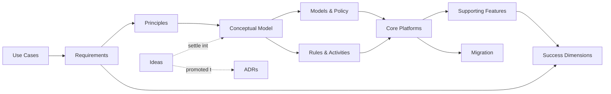

# CFP Network Data — Target State Architecture & Migration

Working conventions: [`AGENTS.md`](AGENTS.md). Status and open issues: [`ISSUES.md`](ISSUES.md).

## Document Map

```
cfp-data/
├── README.md                              # This file — map and navigation
├── AGENTS.md                              # Working conventions (humans + agents)
├── CLAUDE.md                              # Pointer to AGENTS.md
├── ISSUES.md                              # Document status, cross-cutting issues
├── tools/                                 # Validate and render generated doc sections
└── docs/
    ├── problem/                           # Where to, why, for whom, what
    │   ├── 00-vision.md
    │   ├── 01-problem-statement.md        # Current state, consequences, cost
    │   ├── 02-stakeholders-use-cases.md   # UC-n
    │   ├── 03-requirements.md             # R-n, Q-n; trace matrix UC → R → P
    │   └── 04-current-state-constraints.md
    ├── solution/                          # How
    │   ├── 01-principles.md               # Pn
    │   ├── 02-conceptual-model.md         # The shape; ideas settle here
    │   ├── 03-models-policy-governance.md
    │   ├── 04-process-rules-activities.md
    │   ├── 05-core-platforms.md
    │   └── 06-supporting-features.md
    ├── ways-of-working/                   # How we execute
    │   ├── 01-roadmap.md                  # Initiatives, phases, sizing
    │   ├── 02-migration.md                # Per-domain migration cycle
    │   ├── 03-risk-register.md            # Risks of doing
    │   └── 04-success-dimensions.md       # KPIs and thresholds
    ├── glossary.md
    ├── data/                              # CSV / YAML registers: estate, use cases + competency questions
    ├── ideas/                             # Early, non-binding thinking
    ├── adr/                               # Agreed decisions (NNNN-title.md)
    ├── references/                        # External sources; README.md is the register
    ├── archive/                           # Superseded material, out of the main flow
    └── templates/
        └── decision-record.md             # ADR template
```

---

## Key Relationships



---

## Quick Reference — Inputs Mapped to Structure

| Your input | Lives in |
|---|---|
| Who needs what | [Stakeholders & Use Cases](docs/problem/02-stakeholders-use-cases.md) |
| "Define data we need" | [Conceptual Model](docs/solution/02-conceptual-model.md), [Models, Policy & Governance](docs/solution/03-models-policy-governance.md) |
| "Decide what stays and what goes" | [Migration](docs/ways-of-working/02-migration.md), [estate matrix](docs/data/estate-disposition.csv) |
| "Make data discoverable" | [Supporting Features](docs/solution/06-supporting-features.md) (Discovery) |
| "Govern by policy" | [P6](docs/solution/01-principles.md), [Models, Policy & Governance](docs/solution/03-models-policy-governance.md) |
| "Trusted, resilient data" | [Core Platforms](docs/solution/05-core-platforms.md), [Q-1](docs/problem/03-requirements.md) |
| "Observe the network" | [Supporting Features](docs/solution/06-supporting-features.md) (Telemetry) |
| "Enabler and adoption" | [Process, Rules & Activities](docs/solution/04-process-rules-activities.md), [Success Dimensions](docs/ways-of-working/04-success-dimensions.md) |
| AI readiness | [Stakeholders & Use Cases](docs/problem/02-stakeholders-use-cases.md) (three roles), [P9, P10](docs/solution/01-principles.md) |
| Topology, infrastructure assets, metadata registry | [Core Platforms](docs/solution/05-core-platforms.md) |
| Keep existing infrastructure alive | [Migration](docs/ways-of-working/02-migration.md) |
| State and intent is declarative | [P4](docs/solution/01-principles.md) |
