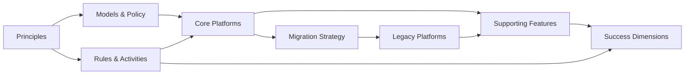

# Network Data — Target State Architecture & Migration

Working conventions for humans and agents: [`AGENTS.md`](AGENTS.md).

## Document Map

```
cfp-data/
├── README.md                          # This file — document map, status
├── AGENTS.md                          # Working conventions (humans + agents)
├── CLAUDE.md                          # Pointer to AGENTS.md
└── docs/
    ├── 01-problem-statement.md        # The problem we're solving (short, pithy, precise)
    ├── 02-risks-and-importance.md     # Why this matters — risk categories
    ├── 03-architecture-principles.md  # Guiding principles for the target state
    ├── 04-major-areas-of-work/
    │   ├── 04-01-models-policy-governance.md
    │   ├── 04-02-process-rules-activities.md
    │   ├── 04-03-core-platforms-mapping.md
    │   ├── 04-04-supporting-features.md
    │   ├── 04-05-migration-strategy.md
    │   └── 04-06-risks-mitigations.md
    ├── 05-initiatives-roadmap.md      # Initiatives, priorities, sequencing
    ├── 06-success-dimensions.md       # How we measure success
    ├── 07-glossary.md                 # Terms, acronyms, conventions
    ├── adr/                           # Architecture Decision Records (NNNN-title.md)
    ├── ideas/                         # Early, non-binding thinking; promoted to ADRs when agreed
    ├── references/                    # External sources (short-name.md)
    └── templates/
        └── decision-record.md         # ADR template
```

---

## Status

| Section | Status | Owner |
|---|---|---|
| [Problem Statement](docs/01-problem-statement.md) | 🟡 Draft | TBD |
| [Risks & Importance](docs/02-risks-and-importance.md) | 🟡 Draft | TBD |
| [Architecture Principles](docs/03-architecture-principles.md) | 🟡 Draft | TBD |
| [Models, Policy, Governance](docs/04-major-areas-of-work/04-01-models-policy-governance.md) | 🔴 Not started | TBD |
| [Process, Rules, Activities](docs/04-major-areas-of-work/04-02-process-rules-activities.md) | 🔴 Not started | TBD |
| [Core Platforms Mapping](docs/04-major-areas-of-work/04-03-core-platforms-mapping.md) | 🔴 Not started | TBD |
| [Supporting Features](docs/04-major-areas-of-work/04-04-supporting-features.md) | 🔴 Not started | TBD |
| [Migration Strategy](docs/04-major-areas-of-work/04-05-migration-strategy.md) | 🔴 Not started | TBD |
| [Risks & Mitigations](docs/04-major-areas-of-work/04-06-risks-mitigations.md) | 🔴 Not started | TBD |
| [Initiatives Roadmap](docs/05-initiatives-roadmap.md) | 🟡 Draft | TBD |
| [Success Dimensions](docs/06-success-dimensions.md) | 🟡 Draft | TBD |
| [Glossary](docs/07-glossary.md) | 🟡 Draft | TBD |
| ADRs | 🔴 None yet | — |
| [Idea: Discovery decoupled from inventory](docs/ideas/discovery-decoupled-from-inventory.md) | 🟡 Idea | Matthias |
| [Idea: Bitemporal, modal inventory](docs/ideas/bitemporal-modal-inventory.md) | 🟡 Idea | Matthias |

---

## Key Relationships



---

## Quick Reference — Inputs Mapped to Structure

| Your input | Lives in |
|---|---|
| "Define data we need" | [04-01](docs/04-major-areas-of-work/04-01-models-policy-governance.md) |
| "Decide what stays and what goes" | [04-05](docs/04-major-areas-of-work/04-05-migration-strategy.md) + [06](docs/06-success-dimensions.md) (Estate Decisions) |
| "Make data discoverable" | [04-04](docs/04-major-areas-of-work/04-04-supporting-features.md) (Discovery) |
| "Govern by policy" | [04-01](docs/04-major-areas-of-work/04-01-models-policy-governance.md) |
| "Trusted, resilient data" | [04-03](docs/04-major-areas-of-work/04-03-core-platforms-mapping.md) + [06](docs/06-success-dimensions.md) (Resilience, Quality) |
| "Observe the network" | [04-04](docs/04-major-areas-of-work/04-04-supporting-features.md) (Telemetry) |
| "Enabler and adoption" | [04-02](docs/04-major-areas-of-work/04-02-process-rules-activities.md) + [06](docs/06-success-dimensions.md) (Adoption) |
| Topology | [04-03](docs/04-major-areas-of-work/04-03-core-platforms-mapping.md) (Instances: static + time-series) |
| Infrastructure assets | [04-03](docs/04-major-areas-of-work/04-03-core-platforms-mapping.md) (Instances: static) |
| Registry for meta-data | [04-03](docs/04-major-areas-of-work/04-03-core-platforms-mapping.md) (Meta-data platform) |
| Keep existing infrastructure alive | [04-05](docs/04-major-areas-of-work/04-05-migration-strategy.md) |
| State and intent is declarative | [03](docs/03-architecture-principles.md) (P6) |
| Policy drive | [04-01](docs/04-major-areas-of-work/04-01-models-policy-governance.md) |
