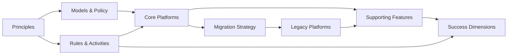

# Network Data — Target State Architecture & Migration

## Document Map

```
docs/
├── README.md                          # This file — document map, status, conventions
├── 01-problem-statement.md            # The problem we're solving (short, pithy, precise)
├── 02-risks-and-importance.md         # Why this matters — risk categories
├── 03-architecture-principles.md      # Guiding principles for the target state
├── 04-major-areas-of-work/
│   ├── 04-01-models-policy-governance.md
│   ├── 04-02-process-rules-activities.md
│   ├── 04-03-core-platforms-mapping.md
│   ├── 04-04-supporting-features.md
│   ├── 04-05-migration-strategy.md
│   └── 04-06-risks-mitigations.md
├── 05-initiatives-roadmap.md          # Initiatives, priorities, sequencing
├── 06-success-dimensions.md           # How we measure success
├── 07-glossary.md                     # Terms, acronyms, conventions
└── templates/                         # Reusable document templates
    └── decision-record.md             # Architecture Decision Record (ADR) template
```

---

## Status

| Section | Status | Owner |
|---|---|---|
| Problem Statement | 🟡 Draft | TBD |
| Risks & Importance | 🟡 Draft | TBD |
| Architecture Principles | 🟡 Draft | TBD |
| Models, Policy, Governance | 🔴 Not started | TBD |
| Process, Rules, Activities | 🔴 Not started | TBD |
| Core Platforms Mapping | 🔴 Not started | TBD |
| Supporting Features | 🔴 Not started | TBD |
| Migration Strategy | 🔴 Not started | TBD |
| Risks & Mitigations | 🔴 Not started | TBD |
| Initiatives Roadmap | 🟡 Draft | TBD |
| Success Dimensions | 🟡 Draft | TBD |

---

## Conventions

1. **One thing, one file.** Each major concern gets its own document. Cross-reference by relative path.
2. **Decisions are recorded.** Every architectural decision gets an ADR in `docs/adr/`. The ADR template is in `templates/decision-record.md`.
3. **Standards-first, hype-last.** We adopt standards where they reduce risk or friction. We do not adopt a technology because it is popular — every choice must be rationally motivated against our principles and requirements.
4. **Living documents.** No section is ever "done." We iterate. Status reflects current confidence, not completeness.
5. **Precision over length.** Each document should be readable in 5 minutes. Detail lives in linked sub-documents or ADRs.

---

## Key Relationships



---

## Quick Reference — Inputs Mapped to Structure

| Your input | Lives in |
|---|---|
| "Define data we need" | `04-01-models-policy-governance.md` |
| "Decide what stays and what does" | `04-05-migration-strategy.md` + `06-success-dimensions.md` (Estate Decisions) |
| "Make data discoverable" | `04-04-supporting-features.md` (Discovery) |
| "Govern by policy" | `04-01-models-policy-governance.md` |
| "Trusted, resilient data" | `04-03-core-platforms-mapping.md` + `06-success-dimensions.md` (Resilience, Quality) |
| "Observe the network" | `04-04-supporting-features.md` (Telemetry) |
| "Enabler and adoption" | `04-02-process-rules-activities.md` + `06-success-dimensions.md` (Adoption) |
| Topology | `04-03-core-platforms-mapping.md` (Instances: static + time-series) |
| Infrastructure assets | `04-03-core-platforms-mapping.md` (Instances: static) |
| Registry for meta-data | `04-03-core-platforms-mapping.md` (Meta-data platform) |
| Keep existing infrastructure alive | `04-05-migration-strategy.md` |
| State and intent is declarative | `03-architecture-principles.md` |
| Policy drive | `04-01-models-policy-governance.md` |
