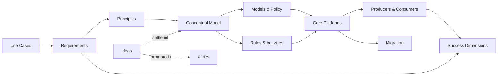

# CFP Network Data — Target State Architecture and Migration

This repository holds the working documents for the CFP Network Data program: where we want to go, why, and how we plan to get there.

Everything here is a draft. We are still collecting the questions the data must answer, so most answers are provisional and will change. Status of each document: [`ISSUES.md`](ISSUES.md). How we work, for people and AI agents alike: [`AGENTS.md`](AGENTS.md).

## Where to Start

Read the vision and the problem statement first. Then read the use cases: they say who needs what, and everything else follows from them.

| If you want to know… | Read |
|---|---|
| Where we want to go | [Vision](docs/problem/00-vision.md) |
| What is wrong today, and what it costs | [Problem Statement](docs/problem/01-problem-statement.md) |
| Who needs what, and which questions the data must answer | [Stakeholders and Use Cases](docs/problem/02-stakeholders-use-cases.md) |
| What the system must do | [Requirements](docs/problem/03-requirements.md) |
| What we know about today's systems and constraints | [Current State and Constraints](docs/problem/04-current-state-constraints.md) |
| The rules we design by | [Principles](docs/solution/01-principles.md) |
| The current working shape of the solution | [Conceptual Model](docs/solution/02-conceptual-model.md) |
| How we plan to deliver, and how we will measure success | [Roadmap](docs/ways-of-working/01-roadmap.md), [Success Dimensions](docs/ways-of-working/04-success-dimensions.md) |
| What is still open | [`ISSUES.md`](ISSUES.md) |
| What a term means | [Glossary](docs/glossary.md) |

## Conventions

- **IDs.** Items carry short IDs so that other documents can refer to them: `UC` use case, `CQ` competency question, `R` functional requirement, `Q` quality requirement, `P` principle, `AC` activity, `I` open issue. Roadmap initiatives are lettered A to G. Each document that defines IDs explains them.
- **`[T]`** marks a threshold we know we need but have not yet set.
- **Ideas** in `docs/ideas/` are thinking in progress. **ADRs** (architecture decision records) in `docs/adr/` record decisions the team has agreed. There are no ADRs yet.

## Document Map

```
cfp-data/
├── README.md                              # This file
├── AGENTS.md                              # How we work (people and AI agents)
├── CLAUDE.md                              # Points to AGENTS.md
├── ISSUES.md                              # Document status and open issues
├── tools/                                 # Scripts that check and generate parts of the documents
└── docs/
    ├── problem/                           # Where we want to go, why, and for whom
    │   ├── 00-vision.md
    │   ├── 01-problem-statement.md        # Current state, consequences, cost
    │   ├── 02-stakeholders-use-cases.md   # Stakeholders, activities, use cases
    │   ├── 03-requirements.md             # Requirements, traced to use cases and principles
    │   └── 04-current-state-constraints.md
    ├── solution/                          # How we intend to solve it
    │   ├── 01-principles.md
    │   ├── 02-conceptual-model.md         # Working shape of the solution
    │   ├── 03-models-policy-governance.md
    │   ├── 04-process-rules-activities.md
    │   ├── 05-core-platforms.md
    │   └── 06-producers-consumers.md      # How modules plug in: producers, consumers, subsystems
    ├── ways-of-working/                   # How we execute the program
    │   ├── 01-roadmap.md                  # Initiatives, phases, sizing
    │   ├── 02-migration.md                # How each domain migrates
    │   ├── 03-risk-register.md            # Risks of running the program
    │   └── 04-success-dimensions.md       # Measures and thresholds
    ├── glossary.md
    ├── data/                              # Structured registers (CSV, YAML): estate, use cases
    ├── ideas/                             # Thinking in progress
    ├── adr/                               # Agreed decisions
    ├── references/                        # External sources; README.md lists them all
    ├── archive/                           # Superseded material
    └── templates/
        └── decision-record.md             # ADR template
```

## How the Documents Relate



## Topics

| Topic | Where |
|---|---|
| Defining the data we need | [Conceptual Model](docs/solution/02-conceptual-model.md), [Models, Policy and Governance](docs/solution/03-models-policy-governance.md) |
| Deciding what stays and what goes | [Migration](docs/ways-of-working/02-migration.md), [estate register](docs/data/estate-disposition.csv) |
| Discovery, monitoring, and other producers | [Producers, Consumers, and Extension Points](docs/solution/06-producers-consumers.md) |
| Governing by policy | [Principles](docs/solution/01-principles.md) (P6), [Models, Policy and Governance](docs/solution/03-models-policy-governance.md) |
| Trusted, resilient data | [Core Platforms](docs/solution/05-core-platforms.md), [Requirements](docs/problem/03-requirements.md) (Q-1) |
| Time-series data and observability | [Producers, Consumers, and Extension Points](docs/solution/06-producers-consumers.md) |
| Enablement and adoption | [Process, Rules and Activities](docs/solution/04-process-rules-activities.md), [Success Dimensions](docs/ways-of-working/04-success-dimensions.md) |
| AI readiness | [Stakeholders and Use Cases](docs/problem/02-stakeholders-use-cases.md) (AI in three roles), [Principles](docs/solution/01-principles.md) (P9, P10) |
| Topology, infrastructure assets, metadata registry | [Core Platforms](docs/solution/05-core-platforms.md) |
| Keeping existing systems running | [Migration](docs/ways-of-working/02-migration.md) |
| Declarative state and intent | [Principles](docs/solution/01-principles.md) (P4) |
